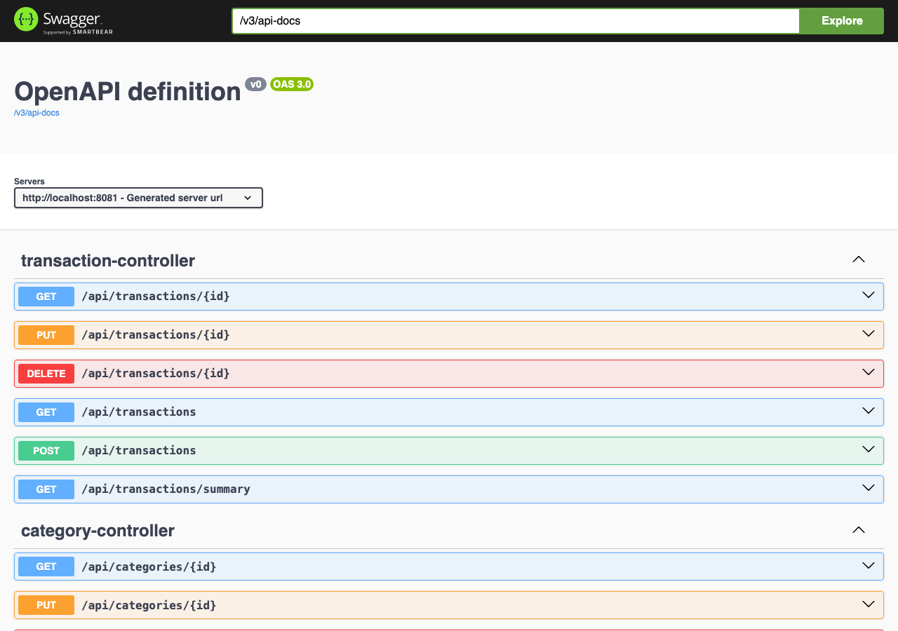
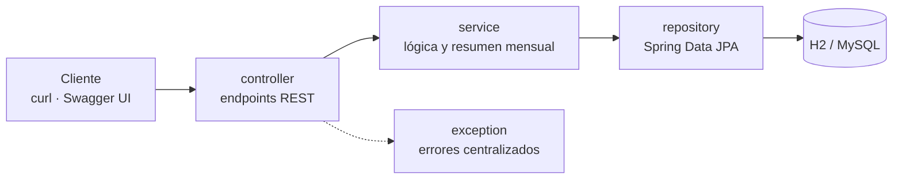

# Finance Tracker API

**API REST para registrar ingresos y gastos personales por categoría y saber, mes a mes, cuánto entra, cuánto sale y en qué se va.**

[](https://github.com/nelsongomezsa/finance-tracker-api/actions/workflows/ci.yml)


> **English summary:** Personal finance REST API built with Java 17 and Spring Boot 3. CRUD for categories and transactions, plus a monthly summary with income, expenses, balance and a per-category breakdown. Bean Validation, centralised error handling, Swagger UI, H2 by default and a MySQL profile. Unit tests with JUnit 5 and Mockito, and web-layer tests with MockMvc.



---

## Qué resuelve

Llevar las cuentas en una hoja de cálculo funciona hasta que quieres saber cuánto has gastado este mes en cada cosa. Esta API guarda cada movimiento con su categoría y calcula el resumen del mes por ti.

## Funcionalidades

- **Categorías** de ingreso o de gasto (CRUD).
- **Transacciones** con descripción, importe, fecha y categoría (CRUD).
- **Resumen mensual**: ingresos totales, gastos totales, balance y desglose por categoría.
- **Validación** de los datos de entrada y **errores centralizados** con respuestas JSON claras.
- **Swagger UI** para probar la API desde el navegador.
- **Datos de ejemplo** precargados al arrancar con H2.

## Stack

| Capa | Tecnología |
|---|---|
| Lenguaje | Java 17 |
| Framework | Spring Boot 3 (Web, Data JPA, Validation) |
| Persistencia | Hibernate / JPA · H2 en memoria (por defecto) · MySQL (perfil `mysql`) |
| Documentación | springdoc-openapi (Swagger UI) |
| Tests | JUnit 5 · Mockito · MockMvc |
| Build | Maven |

## Arquitectura



Los controladores reciben y devuelven DTOs (records de Java), así las entidades JPA nunca salen de la API.

## Cómo ejecutarlo

Requisitos: Java 17 y Maven.

1. **Clona el repositorio**
   ```bash
   git clone https://github.com/nelsongomezsa/finance-tracker-api.git && cd finance-tracker-api
   ```
2. **Arranca la API** (H2 en memoria, con datos de ejemplo)
   ```bash
   mvn spring-boot:run
   ```
3. **Pruébala** en Swagger UI: `http://localhost:8080/swagger-ui.html`

Para usar MySQL: `mvn spring-boot:run -Dspring-boot.run.profiles=mysql`, con `DB_USER` y `DB_PASSWORD` como variables de entorno si no usas `root` / `root`. La base `finance_tracker` se crea sola si no existe.

## Endpoints

| Método | Endpoint | Descripción |
|---|---|---|
| GET | `/api/categories` | Lista todas las categorías |
| POST | `/api/categories` | Crea una categoría |
| PUT | `/api/categories/{id}` | Actualiza una categoría |
| DELETE | `/api/categories/{id}` | Elimina una categoría |
| GET | `/api/transactions` | Lista todas las transacciones |
| POST | `/api/transactions` | Crea una transacción |
| PUT | `/api/transactions/{id}` | Actualiza una transacción |
| DELETE | `/api/transactions/{id}` | Elimina una transacción |
| GET | `/api/transactions/summary?year=2026&month=8` | Resumen del mes |

```bash
curl -X POST http://localhost:8080/api/transactions \
  -H "Content-Type: application/json" \
  -d '{"description": "Nómina agosto", "amount": 1800.00, "date": "2026-08-01", "categoryId": 1}'

curl "http://localhost:8080/api/transactions/summary?year=2026&month=8"
```

## Tests

```bash
mvn test
```

**7 tests**:
- `CategoryServiceTest` (Mockito): listar, buscar, crear y rechazar nombres duplicados.
- `TransactionServiceTest` (Mockito): cálculo del balance y del desglose por categoría del resumen mensual.
- `TransactionControllerTest` (MockMvc): alta correcta con `201` y error `400` si falta la descripción.

## Qué aprendí

- A separar en capas una API de Spring Boot y a no exponer las entidades: los DTOs son records.
- A probar la lógica de negocio aislada con Mockito y la capa web con MockMvc.
- A dar errores útiles con un manejador global en lugar de un `try/catch` en cada endpoint.
- A trabajar con perfiles: H2 para desarrollar sin instalar nada y MySQL para algo más real.

## Próximos pasos

- Más tests: actualizar y borrar, y casos límite del resumen (meses sin movimientos).
- Paginación y filtros por fecha en el listado de transacciones.
- Autenticación para que cada usuario vea solo sus movimientos.

## Autor

**Nelson Gómez Sánchez** · Estudiante de DAM y del Máster en Data & Analytics · [nelsongomezsa.github.io](https://nelsongomezsa.github.io) · [LinkedIn](https://www.linkedin.com/in/nelson-gómez-sánchez)

Licencia [MIT](LICENSE).
